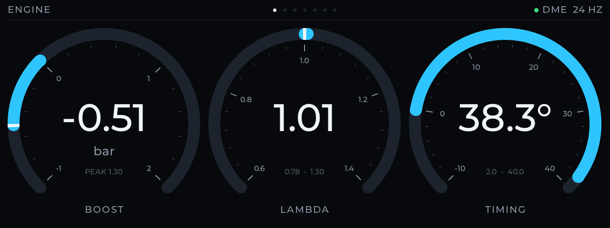
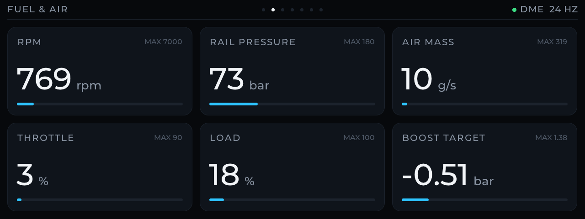
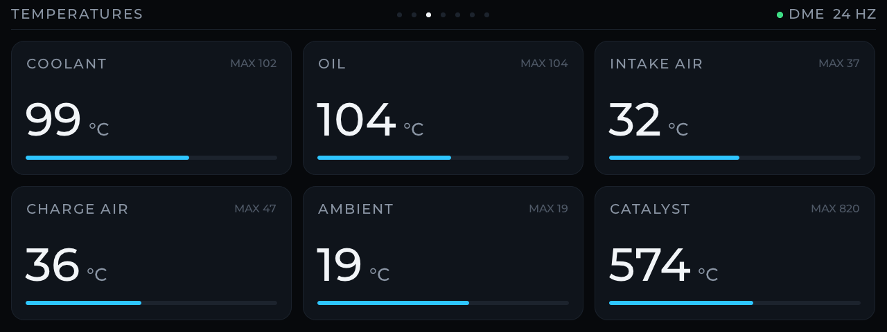
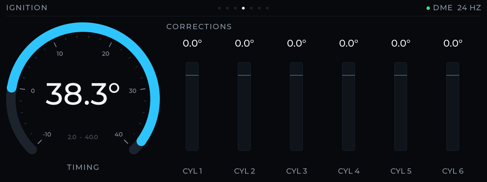
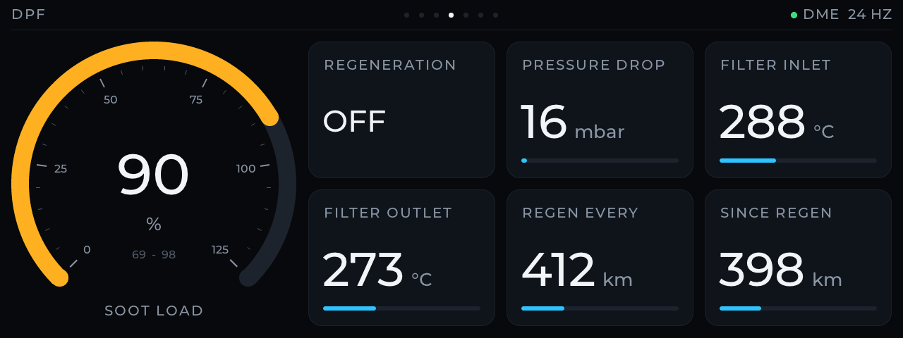
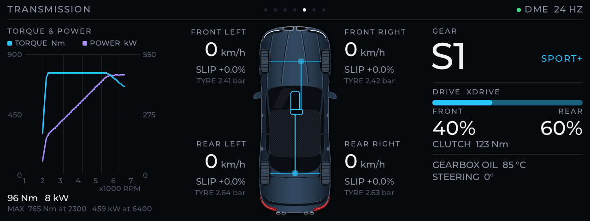
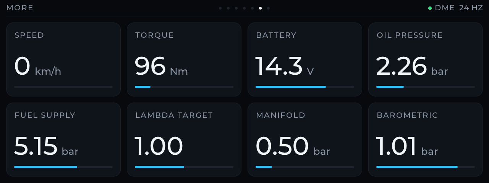
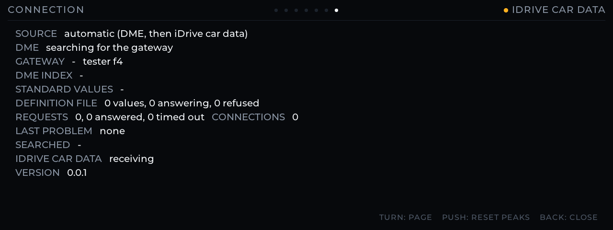

<!-- SPDX-License-Identifier: MPL-2.0 -->
<p align="center">
  <picture>
    <source media="(prefers-color-scheme: dark)" srcset="docs/assets/logo-dark.svg">
    
  </picture>
</p>

<h1 align="center">Gauges for NBT Manager</h1>

> **Warning: installing or modifying this software can brick your head unit. Recovery may require professional service or replacement, at your expense. Provided AS IS; use at your own risk, subject to applicable law.** [Read the risk and liability disclaimer](DISCLAIMER.md).

<p align="center"></p>

Live engine gauges on the iDrive screen, read from the car's computers through
its own gateway: no OBD adapter. An application of
[NBT Manager](https://github.com/NBTFoundry/manager) on the
[NBT App SDK](https://github.com/NBTFoundry/sdk), drawn with
[LVGL](https://lvgl.io). For BMW NBT Evo (iDrive 6) in F-series cars.

**Status:** test build, not yet run in a car ([car test](docs/car-test.md)).
Never interact with the screen while driving.

Part of [NBTFoundry](https://github.com/NBTFoundry). Not affiliated with or
endorsed by BMW AG or BlackBerry Limited. BMW, iDrive and NBT are trademarks of
BMW AG; QNX is a trademark of BlackBerry Limited.

## Pages

<table>
<tr>
<td width="50%" align="center"><br><b>ENGINE</b></td>
<td width="50%" align="center"><br><b>FUEL &amp; AIR</b></td>
</tr>
<tr>
<td align="center"><br><b>TEMPERATURES</b></td>
<td align="center"><br><b>IGNITION</b></td>
</tr>
<tr>
<td align="center"><br><b>DPF</b> (diesels, in place of IGNITION)</td>
<td align="center"><br><b>TRANSMISSION</b></td>
</tr>
<tr>
<td align="center"><br><b>MORE</b></td>
<td align="center"><br><b>CONNECTION</b></td>
</tr>
</table>

Turn the controller to change pages, push to reset peaks (and the torque/power
curves), BACK to close.

## Data

- **DME via the gateway** (HSFZ, UDS, read-only): the standard OBD values
  (`22 F4xx`), batched; anything else from definition files. Through NBT
  Manager's diagnostics (bridge 1.8) for the ECUs the package declares (12,
  13, 18, 19, 29); on its own tester connection when they are not offered.
- **iDrive car data**: rpm, temperatures, torque, speed, acceleration, steering,
  gear, drive mode. Fills in when the DME is not reachable.
- **Demo**: a simulated drive.

## Settings

| Setting | Choices |
| --- | --- |
| Data source | auto, dme, cardata, demo |
| Units | metric, imperial |
| Lambda as | lambda, afr |
| Boost gauge top | 1 to 3 bar |
| Drivetrain | auto, rwd, xdrive |
| Debug log | off, on |

## Definition files

CSV files sent to the app's files from the phone add values the standard ones
lack (per-cylinder corrections, wheel speeds, xDrive split, gearbox, DPF...):

```csv
id,label,unit,ecu,did,pos,type,mul,div,add,min,max
corr1,,,12,XXXX,1,s8,0.375,1,0,,
wastegate,Wastegate,%,12,XXXX,3,u16,100,65535,0,0,100
```

`id` is a built-in value (see `src/channels.cpp`) or a new one for MORE; `ecu`
and `did` in hex; `pos` 1-based, `type` u8/s8/u16/s16/u32/s32 big-endian; value
= raw × mul / div + add. No BMW data is included: identifiers and scalings are
in each ECU's SGBD (`SG_FUNKTIONEN`), decoded by
[bmw-unified-db](https://github.com/gediz/bmw-unified-db).

## Build

```sh
git submodule update --init     # LVGL; the SDK is ../sdk
make -j"$(nproc)" host && make test
make qnx qnx-check vm-test      # head unit build, QNX 6.5 checks
make anims                      # docs/screens/*.webp
```

## License

MPL-2.0. Third-party notices (LVGL, Tiny TTF, Montserrat, SDK) in
[legal/NOTICE.txt](legal/NOTICE.txt).
